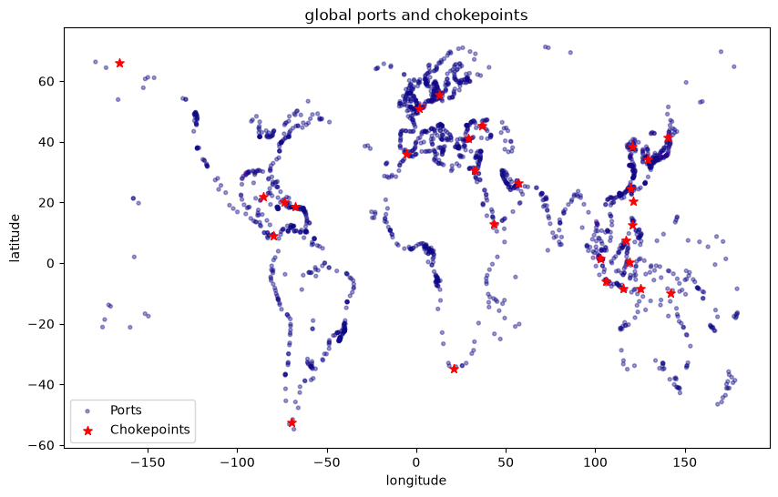
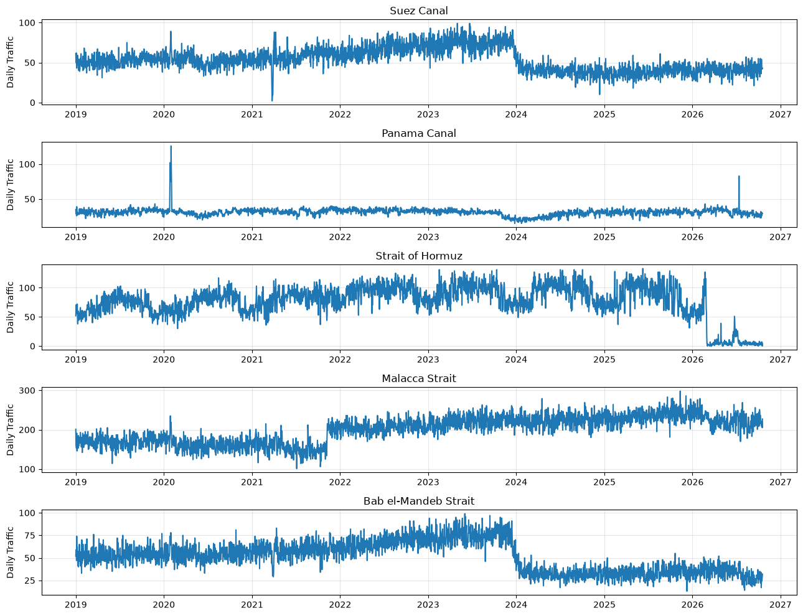

## Maritime Traffic Slowdowns
### Using PortWatch datasets to model traffic slowdowns for maritime commercial shipping. 

#### Jupyter Notebook

[notebook with exploratory analysis, proof of concept](https://samAmabile.github.io/Maritime/analysis.html)

### Modeling Time-Series Data

According to Faouzi (2025), the general assumption of conditional independence of observations required by many standard machine learning algorithms such as the Naive Bayes is not suited for time series data, as the order of the values in the dataset is itself an important feature of observations, and correlation is expected. A recognized technique for adapting time-series for classification is to extract features from the chronological data to use as inputs for a standard classification model. If one variable is used from the time series the model is considered univariate, multiple variables is called multivariate. 

For this analysis a single variable was used, the total number of ships transiting a chokepoint on a given day, meaning the underlying dataset is univariate. Multiple features are calculated from the single variable, so the final feature matrix is multivariate, but the overall model should be considered univariate since all features are derived from the same variable.

[(Faouzi, 2025)](https://inria.hal.science/hal-03558165v2)

There are 28 chokepoints in the data, and in order to predict traffic slowdowns at each chokepoint they should be modeled separately, so the complete dataset is a panel of 28 univariate time series. 

[(Alam, 2020)](https://medium.com/data-science/panel-data-regression-a-powerful-time-series-modeling-technique-7509ce043fa8) 

## Chokepoint Day
### The dataset is chronological, so a unit of observation is a chokepoint day

For dataset $D$, observation $i$, calendar date $t$ and observed chokepoint-date combinations $\Omega$ 

$$D = \{(i, t, \mathbb{Y}_{i, t}): (i, t) \in \Omega\} $$

*Multiple chokepoints are observed over time, but importantly each observation is not independent. They have to be considered as part of a time series, and all sampling, data splitting, predicting, and validating must be designed specifically for temporal data to avoid data leakage.*

#### Ports and Chokepoints

#### Maritime Traffic

#### Datasets: 

- ports 

https://portwatch.imf.org/datasets/acc668d199d1472abaaf2467133d4ca4/about

- chokepoints

https://portwatch.imf.org/datasets/fa9a5800b0ee4855af8b2944ab1e07af/about 

- disruptions

https://portwatch.imf.org/datasets/d9b37bf4b2104c85aebdcc0c1d8a2ab7/about

- daily chokepoint data 

https://portwatch.imf.org/datasets/3da2b9ca97684916b75c4013f95d18ab/about

## Splitting Time Series into Train and Test sets Chronologically 

Time series data has a meaningful chronological order and therefore cannot be shuffled and split like more standard datasets for regression or classification. Instead, we have to split the data chronologically, such that all Training data is taken from before the cutoff date $T_0$, and all Testing is done on the data from after $T_0$. We include a 7 day gap buffer to ensure that none of the training forecast targets use data from the testing period. 

$$
\text{Train} : t < T_0 - 7 
$$
$$
\text{Test} : t \geq T_0 
$$

I picked the date January 1st, 2025 (2025-01-01) for the cutoff, resulting in

Training Rows:  59892

Test Rows:  18156

## Standardization

Before fitting a model, we standardize the features using Scikit-Learn's Standard Scaler. The intention of this is to put all numerical features on the same scale. The general formula 

For feature j:
$$
x_{i, j}^* = \frac{x_{i,j} - \bar{x}_j}{s_j} 
$$

where $s_j$ is the standard deviation of feature j
## Logistic Regression 

Using logistic regression on the scaled features, the model learns a linear combination of regression coefficients $\beta$ for $p$ features

$$
z_i = \beta_0 + \sum_{j=1}^p \beta_j x_{i,j}^*
$$

### Sigmoid function 

The prediction is converted to a value between 0 and 1 representing a probability by the sigmoid function $\sigma(z)$ 

$$
\sigma(z_i) = \frac{1}{1 + e^{-z}}
$$
$$
P(y_i == 1 | X_i) = \sigma(z_i)
$$

For this classification we start with the default classifcation threshold of 0.5 

$$

\hat{y_i} = 
\begin{cases}
1 : &P(y_i==1|X_i) \geq 0.5\\
0 : &P(y_i==1|X_i) < 0.5
\end{cases}
$$

Where a prediction of 1 means the model predicts that traffic will decrease by more than 30% and a predicion of 0 means the model predicts it will not. 

We put the Scaler and Logistic Regression model in a pipeline, fit it to the pre $T_0 - 7$ training data, and test on the post $T_0$ test set.

# Addressing the class imbalance 

To properly evaluate the model's performance, we need to compare it to a default prediction baseline to assess it's performance as either better, worse, or about equal to random chance, and by how much. If class labels were balanced between the two classes ($\{0: \text{No Slowdown}, 1: \text{Slowdown}\}$) we could use a dummy model that predicts each class with 50% probability, or a simple random sample of the classes. Since the classes here are extremely unbalanced, the danger is that a model which predicts $0$ every time would achieve 97% accuracy. Therefore in order to see if this model is learning anything valuable in training we can compare its performance against a model that predicts each class with probability equal to that classes proportion in the dataset. We achieve this using Scikit Learn's Dummy Classifier, set to "prior". 

